<!-- ================================================================= -->
<!-- HERO BANNER & DYNAMIC CATCHY TYPING SVG                           -->
<!-- ================================================================= -->

  

  

<h3 align="center">Software Developer · Backend Systems | Security | Applied AI</h3>

  <i>"I like knowing how things work. Then building them better."</i>
   
  Computer Science & Systems Engineering @ Andhra University ('27)

  
  &nbsp;
  
  &nbsp;
  
  &nbsp;
  
  &nbsp;
  
  &nbsp;
  

---

<!-- ================================================================= -->
<!-- BENTO GRID TELEMETRY HUD & INTERNSHIPS                            -->
<!-- ================================================================= -->

<table width="100%">
  <tr>
    <td width="58%" valign="top">
      <h3>⚡ Engineering Telemetry & Industry Experience</h3>
      

        • 💼 <b>Infosys Springboard</b> (Python Intern · Team Lead): Built <b>PyKV</b>, an async-safe in-memory cache engine with $O(1)$ LRU eviction, append-only log (AOF) persistence, atomic compaction, and primary-standby replication. 
        • 🛡️ <b>Bharat Dynamics Limited (BDL)</b> (Project Intern): Engineered <b>CryptComm</b>, a real-time encrypted messaging service utilizing AES-256-GCM with RSA-OAEP key wrapping, WebSocket rooms, and out-of-band fingerprint validation. 
        • 🎓 <b>Academic Foundation</b>: B.Tech in Computer Science & Systems Engineering at <b>Andhra University</b> (Class of 2027). 
        • 📍 <b>Base</b>: Visakhapatnam, India (IST / UTC +5:30) · <i>Focusing on deterministic runtimes, local-first data ownership, and edge intelligence.</i>
      

    </td>
    <td width="42%" valign="top">
      <h3>📈 Impact By The Numbers</h3>
      <table width="100%" align="center">
        <tr align="center">
          <td width="50%">
            <h2>54+</h2>
            Public Repositories
          </td>
          <td width="50%">
            <h2>4x</h2>
            National Hackathons
          </td>
        </tr>
        <tr align="center">
          <td width="50%">
            <h2>Sub-2s</h2>
            Dropout Recovery SLA
          </td>
          <td width="50%">
            <h2>100%</h2>
            Local-First / Air-Gapped
          </td>
        </tr>
      </table>
    </td>
  </tr>
</table>

---

<!-- ================================================================= -->
<!-- HACKATHON TROPHY CABINET                                          -->
<!-- ================================================================= -->

## 🏆 National Hackathon Trophy Cabinet & Honors

| Event & Organization | Project | Recognition / Mission | Architecture Core |
| :--- | :--- | :--- | :--- |
| **HackAP Innovation Hackathon** | **Tools for Tribals** | **2nd Place Winner** Engineered tech solutions for tribal welfare & education | `Fullstack` `Problem Solving` `Social Impact` |
| **Smart India Hackathon 2026** Ministry of Defence / DRDO | **[TacticalEdge-ANC / VoxShield](https://github.com/Jeswanth-009/VoxShield)** | **Problem Statement 26052** Real-Time Neural Speech Denoising for Battlefield Radio Links | `PyTorch` `ONNX Runtime` `Raspberry Pi 5` `DSP` |
| **Razorpay AI Buildathon 2026** Razorpay & OpenRouter | **[PayPulse](https://github.com/Jeswanth-009/PayPulse)** | **Autonomous Payment Recovery Agent** Intercepts checkout dropouts in $< 2$s & auto-reclaims GMV | `TypeScript` `Claude/OpenRouter` `Razorpay API` |
| **AWS AI for Bharat Hackathon** Amazon Web Services | **[CodeSensei](https://github.com/Jeswanth-009/CodeSensai)** | **AI Reasoning Mentor Extension** Sub-second developer code comprehension copilot (Team XFactor) | `Amazon Bedrock` `Nova Lite v1` `VS Code API` |
| **Sky is the Limit Hackathon** GRID Esports | **[Vanguard](https://github.com/Jeswanth-009/Vanguard)** | **Automated Esports Intelligence Platform** Real-time telemetry scouting dossiers via official GRID API | `GRID Esports API` `Python` `LLM Analysis` |
| **MLH PE Hackathon** Major League Hacking | **[OmniGuard](https://github.com/Jeswanth-009/OmniGuard)** | **Resilient Data Platform Scaffold** High-throughput data access layer with verified schema migrations | `Flask` `Peewee ORM` `PostgreSQL` `uv` |

---

<!-- ================================================================= -->
<!-- SYSTEMS ARCHITECTURE BLUEPRINT (4 PILLARS INCL PRISM MUSIC)       -->
<!-- ================================================================= -->

## 📐 Systems Architecture Philosophy

```mermaid
flowchart TD
    subgraph LocalFirst["Local-First Desktop Engine (Kairo)"]
        A["User History & Records"] --> B[("Local SQLite Vault<br/>16 Migrations")]
        B --> C["Tectonic LaTeX Compiler"]
        C --> D["Deterministic ATS PDF"]
        B --> E["Claim Check Layer"]
        E -.->|Strict Fact Match| F["Optional AI Bullet Rewrites"]
    end
    subgraph EdgeAI["Edge Audio Pipeline (VoxShield / DRDO)"]
        G["Noisy Radio Stream"] --> H["Frame Buffer & DSP Window"]
        H --> I["ONNX Neural Mask on Pi 5"]
        I --> J["Clean Voice Stream"]
    end
    subgraph StreamRecovery["Autonomous FinTech Agent (PayPulse)"]
        K["Checkout Dropout Webhook"] --> L["Sub-2s Root Cause Classifier"]
        L --> M["Personalized Recovery Link"]
        M --> N["GMV Reclaimed"]
    end
    subgraph MediaPipeline["Privacy-First Media Engine (Prism Music)"]
        O["Dual Stream (YT Music & JioSaavn)"] --> P["Native Audio Engine & Equalizer"]
        P --> Q["Line-Synced Lyrics Engine"]
        P --> R["Lossless Playback & On-Device Cache"]
    end
```

---

<!-- ================================================================= -->
<!-- EXECUTIVE FLAGSHIP SHOWCASES                                      -->
<!-- ================================================================= -->

## 🚀 Executive Tier — Flagship Systems

<table>
  <tr>
    <td width="50%" valign="top">
      <h3>🦀 <a href="https://github.com/Jeswanth-009/Kairo">Kairo</a></h3>
      
<b>Local-first career intelligence workspace & deterministic resume engine.</b>

      <ul>
        <li>Embedded <b>Tectonic LaTeX compiler</b> compiling native, ATS-safe PDFs directly on-device.</li>
        <li>16-migration SQLite vault with zero telemetry and OS credential-store key security.</li>
        <li>Optional AI bullet rewrites gated by automated claim checks to eliminate hallucinated facts.</li>
      </ul>
      

        <code>Rust</code> <code>Tauri v2</code> <code>React 18</code> <code>TypeScript</code> <code>SQLite</code> <code>Tailwind</code>
      

      

        <a href="https://jeswanth-009.github.io/Kairo/">🌐 <b>Website</b></a> · 
        <a href="https://jeswanth-009.github.io/Kairo/demo/">🎮 <b>Browser Demo</b></a> · 
        <a href="https://github.com/Jeswanth-009/Kairo/releases/latest">📦 <b>Windows Installer</b></a>
      

    </td>
    <td width="50%" valign="top">
      <h3>🎙️ <a href="https://github.com/Jeswanth-009/VoxShield">TacticalEdge-ANC / VoxShield</a></h3>
      
<b>Edge neural speech enhancement for defence communications (DRDO SIH '26).</b>

      <ul>
        <li>Built for <b>Smart India Hackathon 2026 (Problem Statement 26052)</b> for military comms.</li>
        <li>Custom neural acoustic denoising pipeline running on <b>Raspberry Pi 5</b> with ONNX Runtime.</li>
        <li>100% air-gapped with zero cloud dependencies for tactical field reliability.</li>
      </ul>
      

        <code>Python</code> <code>PyTorch</code> <code>ONNX Runtime</code> <code>Raspberry Pi 5</code> <code>DSP</code>
      

      

        <a href="https://github.com/Jeswanth-009/VoxShield">⭐ <b>VoxShield Repo</b></a> · 
        <a href="https://github.com/Jeswanth-009/anc">🛡️ <b>TacticalEdge Core</b></a>
      

    </td>
  </tr>
  <tr>
    <td width="50%" valign="top">
      <h3>⚡ <a href="https://github.com/Jeswanth-009/PayPulse">PayPulse</a></h3>
      
<b>Autonomous AI payment failure recovery agent (Razorpay AI Buildathon 2026).</b>

      <ul>
        <li>Intercepts payment failures across Razorpay streams in <b>&lt; 2 seconds</b>.</li>
        <li>Diagnoses checkout dropouts via LLM reasoning (Claude / OpenRouter).</li>
        <li>Dispatches personalized, one-click WhatsApp/SMS recovery links with zero customer fatigue.</li>
      </ul>
      

        <code>TypeScript</code> <code>Python</code> <code>Razorpay API</code> <code>Agentic AI</code> <code>FastAPI</code>
      

      

        <a href="https://github.com/Jeswanth-009/PayPulse">⭐ <b>PayPulse Repository</b></a>
      

    </td>
    <td width="50%" valign="top">
      <h3>🗄️ <a href="https://github.com/Jeswanth-009/PyKV-A-Scalable-In-Memory-Key-Value-Store-with-Persistence">PyKV Cache Engine</a></h3>
      
<b>Scalable in-memory key-value store with AOF persistence & replication (Infosys Springboard).</b>

      <ul>
        <li>Strict <b>$O(1)$ LRU eviction</b> and dynamic memory bounds enforcement.</li>
        <li>Durable Append-Only File (AOF) persistence with automated log compaction.</li>
        <li>Primary-to-standby replication and real-time observability telemetry dashboard.</li>
      </ul>
      

        <code>FastAPI</code> <code>Python</code> <code>Distributed Systems</code> <code>Data Structures</code>
      

      

        <a href="https://github.com/Jeswanth-009/PyKV-A-Scalable-In-Memory-Key-Value-Store-with-Persistence">⭐ <b>PyKV Repository</b></a>
      

    </td>
  </tr>
</table>

---

<!-- ================================================================= -->
<!-- SECONDARY PLATFORM & CONSUMER APPS                                -->
<!-- ================================================================= -->

## 📱 Consumer Platforms & Distributed Tools

<table>
  <tr>
    <td width="50%" valign="top">
      <h4>🎵 <a href="https://github.com/Jeswanth-009/Prism-Music">Prism Music</a></h4>
      
Privacy-first open-source Android music streaming player built with <b>Flutter & Dart</b>. Streams YouTube Music & JioSaavn with line-synced lyrics, lossless audio, smart radio recommendations, and native EQ. Zero telemetry, zero accounts, zero ads.

      
<code>Flutter</code> <code>Dart</code> <code>Android</code> <code>Audio Streaming</code>

      
<a href="https://github.com/Jeswanth-009/Prism-Music/releases">📦 <b>Releases & APK</b></a>

    </td>
    <td width="50%" valign="top">
      <h4>📺 <a href="https://github.com/Jeswanth-009/EllipseTV">EllipseTV</a></h4>
      
Fullstack streaming platform for <b>Android TV</b>. Features a TV-optimized client built with <b>Kotlin & Jetpack Compose + ExoPlayer</b> paired with a high-throughput <b>Go backend</b> handling torrent resolution and streaming proxies.

      
<code>Kotlin</code> <code>Jetpack Compose</code> <code>ExoPlayer</code> <code>Go</code> <code>Prowlarr</code>

      
<a href="https://github.com/Jeswanth-009/EllipseTV">⭐ <b>EllipseTV Repo</b></a>

    </td>
  </tr>
  <tr>
    <td width="50%" valign="top">
      <h4>🛡️ <a href="https://github.com/Jeswanth-009/WATCHDOG">WatchDog HIDS & SOC</a></h4>
      
Lightweight, log-driven Host Intrusion Detection System (HIDS) and mini-SIEM. Continuously monitors process lifecycles, memory consumption, and authentication events with dynamic anomaly detection and a glassmorphic SOC dashboard.

      
<code>Python</code> <code>Security Telemetry</code> <code>HIDS</code> <code>SIEM</code> <code>JavaScript</code>

      
<a href="https://github.com/Jeswanth-009/WATCHDOG">⭐ <b>WatchDog Repo</b></a>

    </td>
    <td width="50%" valign="top">
      <h4>🎯 <a href="https://github.com/Jeswanth-009/EchoGraph">EchoGraph</a></h4>
      
Spatial Research Operating System that transforms raw research data (CSVs, audio interviews, docs) into an interactive knowledge graph on an infinite canvas with autonomous collaborating AI agents detecting patterns and contradictions.

      
<code>Python</code> <code>Multi-Agent AI</code> <code>Knowledge Graphs</code> <code>FastAPI</code>

      
<a href="https://github.com/Jeswanth-009/EchoGraph">⭐ <b>EchoGraph Repo</b></a>

    </td>
  </tr>
</table>

---

<!-- ================================================================= -->
<!-- INTERACTIVE ARCADE & REDDIT DEVVIT CORNER                         -->
<!-- ================================================================= -->

## 🕹️ Interactive Arcade & Reddit Devvit Corner

> *Micro-apps and interactive games running directly on Reddit feeds and the browser:*

<table width="100%">
  <tr>
    <td width="25%" align="center">
      <h3>🔴 Karma'a Clash</h3>
      
Daily Reddit "Higher or Lower" karma guessing game built with <b>Devvit Web</b> running live in Reddit feeds.

      <a href="https://github.com/Jeswanth-009/karmaa-clash-reddit-game"><b>Play on Reddit 🎮</b></a>
    </td>
    <td width="25%" align="center">
      <h3>⏱️ Foocos</h3>
      
Sub-10 millisecond precision timing challenge built as a Reddit micro-app with god-mode score streaks.

      <a href="https://github.com/Jeswanth-009/foocos-reddit-game"><b>Play on Reddit ⚡</b></a>
    </td>
    <td width="25%" align="center">
      <h3>🕵️‍♂️ DSA Detective</h3>
      
Gamified algorithmic case-solving platform where players solve DSA mysteries to earn ranks on leaderboards.

      <a href="https://github.com/Jeswanth-009/data-structure-game"><b>Solve Cases 🔍</b></a>
    </td>
    <td width="25%" align="center">
      <h3>📊 Data Quest</h3>
      
Multi-level interactive educational game guiding players through data science pipelines and ML models.

      <a href="https://github.com/Jeswanth-009/data-science-game-v2"><b>Play Quest 🚀</b></a>
    </td>
  </tr>
</table>

---

<!-- ================================================================= -->
<!-- COMPLETE ECOSYSTEM (COLLAPSIBLE EXPANDERS)                         -->
<!-- ================================================================= -->

## 📂 The Complete Project Ecosystem (54+ Repositories)

  
<b>🦀 Systems, Infrastructure, Compilers & High-Performance Runtimes (Click to Expand)</b>

   
  <ul>
    <li><b><a href="https://github.com/Jeswanth-009/Kairo">Kairo</a></b> — Local-first career workspace with embedded Tectonic LaTeX compiler, SQLite & Tauri v2.</li>
    <li><b><a href="https://github.com/Jeswanth-009/PyKV-A-Scalable-In-Memory-Key-Value-Store-with-Persistence">PyKV</a></b> — Scalable in-memory KV store with $O(1)$ LRU eviction, AOF persistence & replication (Infosys Springboard).</li>
    <li><b><a href="https://github.com/Jeswanth-009/Darkidol-LLM-app">Darkidol-LLM-app</a></b> — Native cross-platform LLM desktop application (C++, CMake, Metal, CUDA).</li>
    <li><b><a href="https://github.com/Jeswanth-009/The-Memory-Forecaster-An-LRU-Weather-Engine">The Memory Forecaster</a></b> — LRU cache visualization engine with live hit/miss and eviction telemetry.</li>
    <li><b><a href="https://github.com/Jeswanth-009/WATCHDOG">WATCHDOG</a></b> — Host Intrusion Detection System (HIDS) and log-driven security monitoring framework.</li>
    <li><b><a href="https://github.com/Jeswanth-009/ResilientOps">ResilientOps</a></b> — Supply chain resilience simulation environment powered by Reinforcement Learning.</li>
  </ul>

  
<b>🧠 Applied AI, Neural Speech, Vision & Optimization (Click to Expand)</b>

   
  <ul>
    <li><b><a href="https://github.com/Jeswanth-009/VoxShield">VoxShield</a></b> & <b><a href="https://github.com/Jeswanth-009/anc">TacticalEdge-ANC</a></b> — Real-time tactical audio denoising for defence (DRDO SIH '26, ONNX, Pi 5).</li>
    <li><b><a href="https://github.com/Jeswanth-009/PayPulse">PayPulse</a></b> — Autonomous AI payment failure recovery agent for Razorpay checkout streams.</li>
    <li><b><a href="https://github.com/Jeswanth-009/CodeSensai">CodeSensei</a></b> — AI code reasoning mentor copilot for VS Code (Amazon Bedrock Nova Lite v1).</li>
    <li><b><a href="https://github.com/Jeswanth-009/Vanguard">Vanguard</a></b> — Automated esports scouting intelligence engine powered by GRID Esports API.</li>
    <li><b><a href="https://github.com/Jeswanth-009/EchoGraph">EchoGraph</a></b> — Spatial Research OS with infinite-canvas multi-agent knowledge synthesis.</li>
    <li><b><a href="https://github.com/Jeswanth-009/OptiQRoute">OptiQRoute</a></b> — Quantum-inspired vehicle path planning and delivery fleet routing optimization.</li>
    <li><b><a href="https://github.com/Jeswanth-009/CaptionMaker">CaptionMaker</a></b> — Deep learning image caption generator using InceptionV3 and LSTM in TensorFlow.</li>
  </ul>

  
<b>📱 Mobile, Media Streaming & Web Platforms (Click to Expand)</b>

   
  <ul>
    <li><b><a href="https://github.com/Jeswanth-009/Prism-Music">Prism Music</a></b> — Privacy-first Android music streaming app (Flutter/Dart, YouTube Music, JioSaavn).</li>
    <li><b><a href="https://github.com/Jeswanth-009/EllipseTV">EllipseTV</a></b> — Fullstack Android TV streaming client (Jetpack Compose) + Go backend proxy.</li>
    <li><b><a href="https://github.com/Jeswanth-009/CryptComm">CryptComm</a></b> — End-to-end encrypted messaging platform built during Bharat Dynamics Limited (BDL) internship.</li>
    <li><b><a href="https://github.com/Jeswanth-009/codeiam-website">codeiam-website</a></b> — Official web portal for Andhra University's Innovation Ecosystem.</li>
    <li><b><a href="https://github.com/Jeswanth-009/song-chart-scraper">Song Chart Scraper</a></b> — Kworb worldwide music chart scraper with daily cron automation.</li>
    <li><b><a href="https://github.com/Jeswanth-009/StudentConnectPortalnew">StudentConnectPortal</a></b> — Social media and collaboration platform for students and campus notes.</li>
    <li><b><a href="https://github.com/Jeswanth-009/JSK_Portfolio">JSK_Portfolio</a></b> — Personal developer portfolio website in TypeScript & React.</li>
    <li><b><a href="https://github.com/Jeswanth-009/Movie_search_react">Movie_search_react</a></b> — React-based movie search and recommendation application.</li>
  </ul>

  
<b>🛠️ Developer Tools, ML Scaffolds & Utilities (Click to Expand)</b>

   
  <ul>
    <li><b><a href="https://github.com/Jeswanth-009/OmniGuard">OmniGuard</a></b> — Flask + Peewee data platform scaffold for MLH PE Hackathon.</li>
    <li><b><a href="https://github.com/Jeswanth-009/Automated_File_Backup">Automated File Backup</a></b> — Python-based automated file synchronization and backup utility.</li>
    <li><b><a href="https://github.com/Jeswanth-009/Youtube_Video_Downloader">Youtube Video Downloader</a></b> — Fast, lightweight Python YouTube media extractor.</li>
    <li><b><a href="https://github.com/Jeswanth-009/Text-Extractor">Text-Extractor</a></b> — OCR and document text parsing utility.</li>
    <li><b><a href="https://github.com/Jeswanth-009/EmployeeSalaryPredictionModel">Employee Salary Prediction</a></b> — Machine learning regression model on salary metrics.</li>
    <li><b><a href="https://github.com/Jeswanth-009/Water-Quality-Prediction-Model">Water Quality Prediction</a></b> — Supervised predictive model for environmental water potability.</li>
  </ul>

---

<!-- ================================================================= -->
<!-- UNIFIED TECHNICAL STACK & CODEBASE ANALYTICS                      -->
<!-- ================================================================= -->

## 💻 Technical Stack & Codebase Analytics

  

<!-- Single Authoritative 54-Repo Language & Systems Distribution -->
<table width="100%">
  <tr>
    <td width="50%" valign="top">
      <h4>🛠️ 54-Repository Language Breakdown</h4>
      

        
         
        <i>Backend systems, ONNX edge DSP audio (VoxShield), caching engines (PyKV), and ML.</i>
      

      

        
         
        <i>Autonomous agents (PayPulse), Reddit Devvit micro-apps, and fullstack platforms.</i>
      

      

        
         
        <i>Interactive learning engines, SOC telemetry dashboards, and web tooling.</i>
      

    </td>
    <td width="50%" valign="top">
      <h4>⚡ Systems & Native Runtimes</h4>
      

        
         
        <i>Desktop workspace runtime & Tectonic LaTeX engine in <b>Kairo</b>.</i>
      

      

        
         
        <i>High-throughput torrent resolution and proxy streaming in <b>EllipseTV</b>.</i>
      

      

        
         
        <i>Cross-platform audio player & synced lyrics engine in <b>Prism Music</b>.</i>
      

      

        
         
        <i>Hardware acceleration (Metal/CUDA) and neural audio models.</i>
      

    </td>
  </tr>
</table>

---

<!-- ================================================================= -->
<!-- BALANCED 2-COLUMN ACTIVITY: TOP LANGUAGES & STREAK (NO DUPLICATES)-->
<!-- ================================================================= -->

## 📊 Live GitHub Activity & Analytics

<table width="100%">
  <tr>
    <td width="50%" align="center" valign="middle">
      
    </td>
    <td width="50%" align="center" valign="middle">
      
    </td>
  </tr>
</table>

 

<!-- SINGLE CONTRIBUTION SNAKE ANIMATION (NO DUPLICATES) -->

  

---

<!-- ================================================================= -->
<!-- FOOTER & VERIFIED REAL-TIME VISITOR COUNT (NO 404 ICONS)          -->
<!-- ================================================================= -->

  
   
  
   
  <i>Crafted with precision by Jeswanth Sai Kancharana · Always building.</i>

